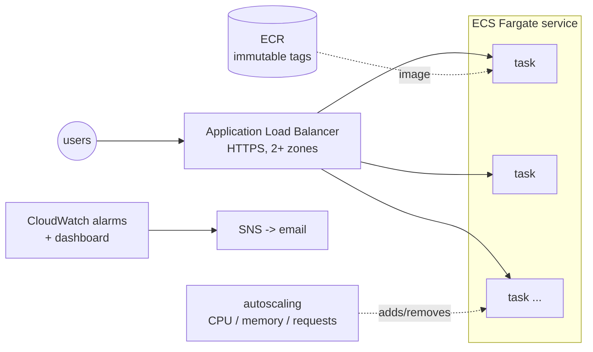

# Skill: provision-aws-ecs

Builds this, all in Terraform (`deploy/templates/terraform`):



| Piece | Why it matters |
|-------|----------------|
| Load balancer across 2+ availability zones | one data-center failure or one bad task does not take the site down |
| ECS Fargate | containers without servers to patch |
| Rolling deploy, `minimum healthy 100%` | zero downtime: new tasks must pass health checks before old ones stop |
| Deployment circuit breaker | a broken release is **rolled back automatically** |
| Target-tracking autoscaling | more tasks when busy, fewer when quiet, between `min_count` and `max_count` |
| Alarms: 5xx, p95 latency, no healthy tasks, unhealthy tasks, low task count, CPU/memory, failed deployments | you hear about problems before users tell you; each links to a runbook in `docs/RUNBOOKS.md` |
| Secrets as SSM/Secrets Manager ARNs | secret values never enter Terraform state or git |

**Cost** (us-east-1, rough): staging (1 small task, no NAT) about 25-35 USD/month (load balancer about 18 + Fargate +
CloudWatch). Production (2+ tasks, NAT gateway, Container Insights) about 80-150 USD/month. Tell the user before applying.

## Prerequisites

- App containerized with a `/healthz` endpoint (`containerize-app`).
- An AWS account, the AWS CLI, `terraform` >= 1.11 and `jq` locally. Credentials via `aws sso login` (or another
  short-lived method). **Never** long-lived access keys pasted anywhere.
- Confirm the account first: `aws sts get-caller-identity` and read the account id back to the user.
- For HTTPS: a domain, and an ACM certificate for it in the same region (ACM console -> request -> DNS validation).

## Procedure

### 1. Copy the templates
```bash
mkdir -p infra && cp -R deploy/templates/terraform/. infra/
```
Edit every `CHANGE_ME` (`grep -rn CHANGE_ME infra`): app name, region, alarm email, certificate ARN (production).

### 2. Bootstrap, once per AWS account (a human runs this with admin rights)
```bash
cp infra/bootstrap/example.tfvars infra/bootstrap/terraform.tfvars    # edit: region, app_name, github_repository (loaded automatically)
```
Add to `deploy/targets.bootstrap.env`: `TF_DIR=infra/bootstrap`. Then the usual saved-plan flow:
```bash
ENVIRONMENT=bootstrap bash deploy/scripts/terraform.sh plan
ENVIRONMENT=bootstrap APPLY=1 bash deploy/scripts/terraform.sh apply   # after approval
terraform -chdir=infra/bootstrap output
```
It creates the state bucket, the ECR repository and the GitHub OIDC roles. Its own state is local: right after the apply,
move it into the new bucket (add a `backend "s3"` block with `key = "bootstrap/terraform.tfstate"` to
`infra/bootstrap/main.tf`, then `terraform -chdir=infra/bootstrap init -migrate-state`). Put the bucket name into the
`backend "s3"` blocks of `infra/envs/*/main.tf`.

### 3. First image
CI normally pushes images. For the very first apply, either set up `setup-cd-pipeline` now and let it run, or push once by hand:
```bash
aws ecr get-login-password | docker login --username AWS --password-stdin <account>.dkr.ecr.<region>.amazonaws.com
docker build --platform linux/amd64 -t <ecr_repository_url>:$(git rev-parse --short=12 HEAD) .
docker push <ecr_repository_url>:$(git rev-parse --short=12 HEAD)
```

### 4. Staging environment (deploy-terraform-aws flow)
`deploy/targets.staging.env`: `TF_DIR=infra/envs/staging`.
```bash
ENVIRONMENT=staging TF_VAR_image_tag=<sha> bash deploy/scripts/terraform.sh plan
```
Walk the user through the summary (about 40 resources are created on the first run, nothing deleted). After approval:
```bash
ENVIRONMENT=staging TF_VAR_image_tag=<sha> APPLY=1 bash deploy/scripts/terraform.sh apply
terraform -chdir=infra/envs/staging output       # url, dashboard_url, log_group
```
Commit the `.terraform.lock.hcl` files Terraform created (they pin provider versions; preflight wants a clean tree).
The apply waits until the service is stable. Then: confirm the alarm-email subscription (AWS sends a link), and run
`post-deploy-verify` with `HEALTH_URL=$(terraform -chdir=infra/envs/staging output -raw url)/healthz`.

### 5. Production
Same with `infra/envs/production` (private subnets, 2+ tasks, HTTPS, deletion protection). Point the domain at
`alb_dns_name` (CNAME, or a Route 53 alias with `alb_zone_id`). Production applies need `CONFIRM_PROD=yes-deploy-prod`
and the user's approval naming production and the tag.

### 6. Automate
`setup-cd-pipeline` with `deploy-aws-ecs.yml` and `terraform-drift.yml`.

## Day-2 operations

| Task | How |
|------|-----|
| Deploy a new version | CD does it; by hand: plan/apply with `TF_VAR_image_tag=<new sha>` |
| Roll back | plan/apply with the previous good tag (ECS also auto-rolls back failed deploys) |
| Infra-only change (sizes, alarms) | `TF_VAR_image_tag=$(terraform -chdir=infra/envs/<env> output -raw image_tag)` so the running version is kept |
| Add a secret | create an SSM SecureString (`aws ssm put-parameter --type SecureString ...`, the user types the value), add its ARN to `secrets` |
| Scale limits | `min_count` / `max_count` / `cpu` / `memory` in `infra/envs/<env>/main.tf` |
| Read logs | `aws logs tail /ecs/<app>-<env> --follow --since 15m` |

## Safety notes specific to this stack

- Each image deploy replaces `aws_ecs_task_definition` (a new immutable revision). `terraform.sh` treats that one type
  as a routine replacement (`TF_REPLACE_OK`, shown in the summary) so normal deploys do not need `ALLOW_DESTROY`.
  Any other delete/replace still requires explicit approval. Never add data-holding types to `TF_REPLACE_OK`.
- The deploy role can create IAM roles named `<app>-*`. Keep **Required reviewers** on the production environment.
- Changing `name`, `vpc_cidr`, `az_count` or `private_subnets` later replaces networking: plan it in a quiet window.

## Roadmap references

[Terraform level](https://github.com/mascot200/devops-roadmap/blob/main/level-07-terraform-iac/README.md) ·
[State and remote backends](https://github.com/mascot200/devops-roadmap/blob/main/level-07-terraform-iac/04-state-and-remote-backends.md) ·
[Zero-downtime deployments](https://github.com/mascot200/devops-roadmap/blob/main/level-05-cicd/08-zero-downtime-deployments.md) ·
[Least-privilege IAM](https://github.com/mascot200/devops-roadmap/blob/main/level-11-security-devsecops/02-least-privilege-iam.md) ·
[Project 4 - Terraform](https://github.com/mascot200/devops-roadmap/blob/main/projects/project-04-terraform.md)
