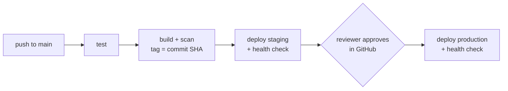

# Skill: setup-cd-pipeline

Turns the manual flow (preflight -> dry run -> approval -> apply -> verify) into a pipeline that runs on every push to
`main`. The pipeline calls **the same scripts** as the manual flow, so all their guards still hold: immutable tags,
`APPLY=1`, the production guard, saved-plan Terraform, refusal of destructive plans, health checks.

## Prerequisites

- The app is containerized (`containerize-app`) and has a test command.
- The target is set up and was deployed **once by hand** successfully: `setup-vps` + `deploy-compose-vps`, or
  `provision-aws-ecs`. Never debug a target for the first time through CI.
- The toolkit is committed in the repo (`deploy/`, `.claude/`), including `deploy/scripts`.

## Pick the pipeline

| Target | Copy | To |
|--------|------|----|
| VPS | `deploy/templates/github-actions/deploy-vps.yml` | `.github/workflows/deploy.yml` |
| VPS rollback button | `deploy/templates/github-actions/rollback-vps.yml` | `.github/workflows/rollback.yml` |
| AWS ECS | `deploy/templates/github-actions/deploy-aws-ecs.yml` | `.github/workflows/deploy.yml` |
| AWS drift check | `deploy/templates/github-actions/terraform-drift.yml` | `.github/workflows/drift.yml` |

Then edit the `test` job (marked `ADJUST`) with the project's real test command. If the repo already has a CI workflow
with tests, keep it and keep the template's test job minimal, or make `build` depend on it.

## GitHub settings checklist (the user clicks these; give them this list)

**Settings -> Environments**: create `staging` and `production`. On `production` enable **Required reviewers** (add
themselves or the team) and optionally restrict deployment branches to `main`. That reviewer approval *is* the production
sign-off: it is why the production job may set `CONFIRM_PROD=yes-deploy-prod`.

### VPS pipeline
| Where | Name | Value |
|-------|------|-------|
| repository variable | `APP_NAME` | e.g. `shop-api` |
| each environment, variables | `VPS_HOST`, `VPS_USER`, `VPS_APP_DIR`, `HEALTH_URL` | as in `deploy/targets.<env>.env` |
| each environment, secret | `VPS_SSH_KEY` | private key of a **new key pair used only by CI** (`ssh-keygen -t ed25519 -f ci_deploy -C ci`), its `.pub` appended to `~deploy/.ssh/authorized_keys` on the server |
| each environment, secret | `VPS_KNOWN_HOSTS` | output of `ssh-keyscan -t ed25519 <host>` (pins the server's identity; prevents man-in-the-middle) |

The user creates the key pair and pastes the secrets into GitHub themselves; **never** ask them to paste a private key
into the chat. If the GHCR package is private, the server needs `docker login ghcr.io` once (see `setup-vps`).

### AWS ECS pipeline
| Where | Name | Value (outputs of `infra/bootstrap`) |
|-------|------|------|
| repository variable | `AWS_REGION` | e.g. `us-east-1` |
| repository variable | `ECR_REPOSITORY` | the `app_name` |
| repository variable | `AWS_CI_PUSH_ROLE_ARN` | `ci_push_role_arn` |
| repository variable | `AWS_DEPLOY_ROLE_ARN` | `deploy_role_arn` |
| repository variable | `AWS_READONLY_ROLE_ARN` | `readonly_role_arn` (drift check) |

No AWS access keys: GitHub's OIDC token is exchanged for 1-hour credentials, and the deploy role trusts only the
`staging` and `production` environments of this one repository.

## Procedure

1. Copy the workflow(s), edit the `test` job, show the user the diff.
2. Give the user the settings checklist above for their target; wait until they confirm it is done.
3. Commit on a branch and open a pull request. Workflows on a PR do not deploy (they trigger on `main` only).
4. After merge, watch the first run with the user (Actions tab). Expected: `test` -> `build` -> `deploy-staging`
   succeed, `deploy-production` shows **Waiting for review**.
5. Before approving production, run `post-deploy-verify` against staging. Then approve in GitHub.

## What happens on failure (tell the user)

| Failure | Result |
|---------|--------|
| tests or critical vulnerabilities | nothing is deployed |
| VPS health check fails after deploy | `AUTO_ROLLBACK=1` restores the previous version; job fails |
| ECS tasks never become healthy | ECS circuit breaker rolls back; the Verify step fails the job |
| Terraform plan deletes/replaces a resource | the job fails before applying: a human reviews and applies it with the `deploy-terraform-aws` skill |
| production not approved | nothing happens; the run expires after 30 days |

Rollback by hand: VPS - **Actions -> rollback -> Run workflow** (optionally with a known-good tag). AWS - re-run the
deploy workflow of the last good commit (Actions -> pick that run -> Re-run all jobs), which plans that commit's tag again.

## Hard rules

- Never put secrets in workflow files, `deploy/targets.*.env` or logs. Use GitHub environment secrets.
- Never tag images `latest` or deploy by branch name. The tag is the commit SHA.
- Never give the pipeline `ALLOW_DESTROY=1`. Destructive infrastructure changes are applied by a human.
- Pin third-party actions to a major version at least; for stricter supply-chain security pin to a full commit SHA.

## Roadmap references

[CI/CD level](https://github.com/mascot200/devops-roadmap/blob/main/level-05-cicd/README.md) ·
[Rollback](https://github.com/mascot200/devops-roadmap/blob/main/level-05-cicd/07-rollback.md) ·
[Terraform CI/CD](https://github.com/mascot200/devops-roadmap/blob/main/level-07-terraform-iac/07-terraform-ci-cd.md) ·
[Project 3 - CI/CD](https://github.com/mascot200/devops-roadmap/blob/main/projects/project-03-cicd.md)
