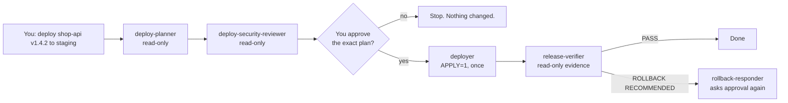

# devops-deploy-toolkit

**Claude Code agents, skills and safe deployment scripts** for shipping an application to a VPS, AWS, Kubernetes or a GitOps
cluster - with a hard rule built into the code: **look first, change only when a human has approved the plan.**

It is the hands-on companion to the [DevOps Roadmap: Beginner to Senior](https://github.com/mascot200/devops-roadmap) curriculum,
and every skill links back to the lesson that explains the "why".



## What is inside

| Kind | Name | Purpose |
|------|------|---------|
| Skill | `deploy-preflight` | clean tree, deployable branch, immutable tag, secret scan, tests, tools |
| Skill | `deploy-compose-vps` | Docker Compose on a VPS over SSH, health check, one-command rollback |
| Skill | `deploy-terraform-aws` | `plan` -> review -> apply the **saved** plan; drift check |
| Skill | `deploy-helm-k8s` | lint, diff, `upgrade --atomic --wait`, rollout status, `helm rollback` |
| Skill | `deploy-gitops-argocd` | promote by pull request, sync, rollback by `git revert` |
| Skill | `post-deploy-verify` | smoke test + error rate/latency/restarts with explicit PASS thresholds |
| Agent | `deploy-planner` | turns "deploy X" into a written plan with risks, verification and rollback (read-only) |
| Agent | `deploy-security-reviewer` | reviews Dockerfiles, manifests, Terraform, CI before shipping (read-only) |
| Agent | `deployer` | executes an **approved** plan; refuses without the approval handshake |
| Agent | `release-verifier` | evidence-based verdict after a release (read-only) |
| Agent | `rollback-responder` | restores the last good version with approval, drafts the incident timeline |
| Agent | `drift-auditor` | finds manual changes vs Git (Terraform, Helm, Argo CD); never fixes (read-only) |
| Scripts | `deploy/scripts/*.sh` | the commands the skills call; dry-run by default |

## Install into your application repo

```bash
git clone https://github.com/mascot200/devops-deploy-toolkit.git
cd your-app-repo
../devops-deploy-toolkit/install.sh          # or: ../devops-deploy-toolkit/install.sh --dry-run
cp deploy/targets.example.env deploy/targets.staging.env   # edit; git-ignored
```

The installer copies `.claude/agents`, `.claude/skills` and `deploy/`, appends a marked rules block to your `CLAUDE.md` and
git-ignore entries, never overwrites a file you changed (use `--force` to), and is safe to run repeatedly.
Then open Claude Code in your app repo and try:

```text
Use the deploy-planner agent to plan a staging deployment of shop-api tag 3f9c1ab with Helm.
```

## The safety model

| Layer | Behaviour |
|-------|-----------|
| Dry-run by default | scripts change nothing unless `APPLY=1`; dry runs print exactly what would run |
| Human approval | the `deployer` needs an `APPROVED_PLAN` block plus the user's quoted approval; production approval must name the environment and version |
| Production guard | `APPLY=1` in production also needs `CONFIRM_PROD=yes-deploy-prod` |
| No floating tags | `latest`/`main`/`master`/`stable`/`dev` are rejected |
| Terraform | applies only the reviewed plan file; refuses stale plans, plans from another commit and plans that delete/replace (unless `ALLOW_DESTROY=1`) |
| Helm | `--atomic --wait`; explicit `--kube-context` on every call |
| GitOps | a pull request merge is the deployment; rollback refuses promotions that were never merged |
| Read-only agents | the planner, security reviewer, verifier and drift auditor have no `Edit`/`Write` tools |
| No secrets in files | credentials come from your SSH agent, `aws sso login`/OIDC and kubectl contexts |

## Honest limits

- The scripts and definitions are tested with **stub binaries and real local git** (`bash tests/run-tests.sh`, 80 checks, also run in CI).
  They have **not** been run against a real AWS account, cluster or VPS by the authors. Treat your first run as a staging rehearsal and read every dry run.
- Claude Code permission prompts remain your outer safety net. See [docs/GUIDE.md](docs/GUIDE.md#6-permissions-and-the-outer-safety-net).
- No license file is included yet; add the license you want before reusing this outside your own projects.

## Documentation

[docs/GUIDE.md](docs/GUIDE.md) - setup, a workflow for each target with example prompts, the approval handshake, scheduling drift
audits, extending the toolkit and troubleshooting.

Part of the DevOps Roadmap course, taught by Ubong Eduok.
