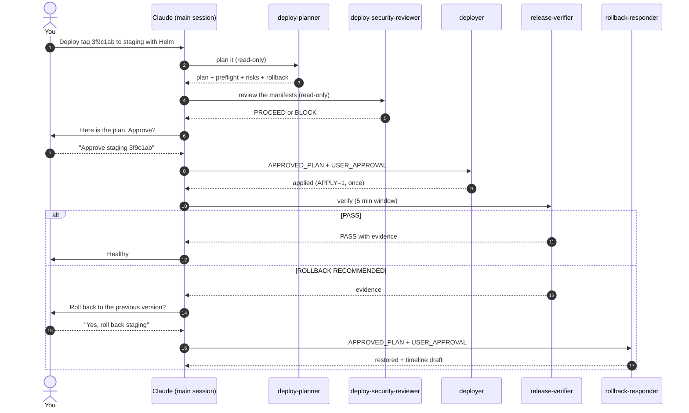

# devops-deploy-toolkit - User Guide

> Plan first. Apply only when a human has approved *that* plan. Prove it worked. Know how to undo it.

## Contents

1. [How the pieces fit](#1-how-the-pieces-fit)
2. [Setup](#2-setup)
3. [The approval handshake](#3-the-approval-handshake)
4. [Workflows by target (with example prompts)](#4-workflows-by-target)
5. [Verification, rollback and drift](#5-verification-rollback-and-drift)
6. [Permissions and the outer safety net](#6-permissions-and-the-outer-safety-net)
7. [Extending the toolkit](#7-extending-the-toolkit)
8. [Troubleshooting](#8-troubleshooting)
9. [Mapping to the DevOps Roadmap](#9-mapping-to-the-devops-roadmap)

---

## 1. How the pieces fit

Three layers, each with one job:

| Layer | Files | Job |
|-------|-------|-----|
| **Scripts** | `deploy/scripts/*.sh` | do the work; dry-run unless `APPLY=1` |
| **Skills** | `.claude/skills/*/SKILL.md` | the *procedure*: which script, in which order, what to check, when to stop |
| **Agents** | `.claude/agents/*.md` | *roles* with limited tools: plan, review, deploy, verify, roll back, audit |



Sub-agents cannot talk to you directly. They return to the main session, which asks you. That is why the approval is
**passed to the agent as text** (section 3), and why every agent's output ends with the question the main session must ask.

## 2. Setup

**Install into the repo you deploy from** (the one Claude Code is opened in):

```bash
git clone https://github.com/mascot200/devops-deploy-toolkit.git ../devops-deploy-toolkit
cd your-app-repo
../devops-deploy-toolkit/install.sh --dry-run   # see what will be copied
../devops-deploy-toolkit/install.sh
```

**Describe your targets** (hostnames and names only - never secrets):

```bash
cp deploy/targets.example.env deploy/targets.staging.env
cp deploy/targets.example.env deploy/targets.production.env
$EDITOR deploy/targets.staging.env
```

**Tools you need, per target**

| Target | Local tools | Access |
|--------|-------------|--------|
| Docker Compose on a VPS | `ssh`, `curl` | SSH key in your agent; Docker + Compose plugin on the server; compose file uses `${IMAGE}:${IMAGE_TAG}` |
| AWS with Terraform | `terraform`, `jq`, `aws` | `aws sso login` (or OIDC in CI); remote state with locking |
| Kubernetes with Helm | `helm`, `kubectl` (+ `helm-diff` plugin) | a kubectl context; chart exposes `image.tag` |
| GitOps with Argo CD | `git`, `argocd` (+ `kustomize`) | `argocd login`; a clone of the GitOps repo |

**Check your setup before the first deployment**

```bash
TARGET=helm ENVIRONMENT=staging bash deploy/scripts/preflight.sh 3f9c1ab
```

## 3. The approval handshake

The `deployer` (and `rollback-responder`) only apply when their invocation contains both blocks:

```text
APPROVED_PLAN:
Target: helm   Environment: staging   Version: 3f9c1ab
Steps: preflight -> helm diff -> helm upgrade --install --atomic --wait -> rollout status
Rollback: helm rollback shop-api (previous revision)

USER_APPROVAL:
"Yes, deploy 3f9c1ab to staging."
```

They refuse (and say exactly what is missing) when:

- either block is missing, or the approval does not match the plan's environment and version;
- the environment is **production** and the approval does not name the environment and the version;
- the plan deletes or replaces Terraform resources and the approval does not mention them;
- the plan to execute differs from the approved plan in any way.

Without approval the `deployer` still helps: it runs the **dry run** and ends with `READY TO APPLY - AWAITING APPROVAL`
and the exact command to confirm.

Two more guards live in the scripts, so they hold even if an agent misbehaves: `APPLY=1` is required for every change, and
production also requires `CONFIRM_PROD=yes-deploy-prod`.

## 4. Workflows by target

Each workflow is: **preflight -> plan/dry-run -> security review (when infra or images changed) -> approval -> apply -> verify**.
Example prompts you can paste into Claude Code in your app repo.

### 4.1 Docker Compose on a VPS

```text
Use the deploy-planner agent to plan deploying ghcr.io/acme/shop-api tag 3f9c1ab to staging on the VPS.
```
```text
Looks good. Approve: deploy 3f9c1ab to staging. Use the deployer agent, then release-verifier.
```
What happens: the script records `.deploy/current_tag`/`previous_tag` on the server, pulls the image, runs `docker compose up -d`,
then polls `HEALTH_URL`. Roll back with `compose-deploy.sh rollback`. Set `AUTO_ROLLBACK=1` in the targets file only if you want
automatic rollback on a failed health check.

### 4.2 AWS with Terraform

```text
Run a Terraform plan for staging and walk me through anything that is deleted or replaced.
```
```text
Approved: apply the staging plan you just showed me. No deletions are in it. Use the deployer agent.
```
The plan is saved as `tfplan`; `apply` uses only that file and refuses it when it is older than an hour or was made from a different commit.
If a database or server will be replaced, you must say so in your approval for `ALLOW_DESTROY=1` to be used. Check the AWS account first
(`aws sts get-caller-identity`) - the skill makes the agent read it back to you.

### 4.3 Kubernetes with Helm

```text
Plan a Helm deployment of tag 3f9c1ab to the staging namespace and show me the diff.
```
```text
Approved: helm upgrade shop-api to 3f9c1ab in staging.
```
`helm upgrade --install --atomic --wait --timeout 5m` means a release whose Pods never become Ready is rolled back by Helm itself.
If the cluster is managed by Argo CD or Flux, use the GitOps workflow instead; a manual `helm upgrade` would be reverted.

### 4.4 GitOps with Argo CD

```text
Promote tag 3f9c1ab to staging through the GitOps repo and tell me when the pull request is ready to merge.
```
The `bump` step pushes `promote/shop-api-staging-3f9c1ab`; **merging the pull request is the deployment**. Production promotions are
never merged by the agent. Roll back with `gitops-promote.sh rollback <sha of the merged promotion>`, which creates a revert branch.

### 4.5 Promote the same version up the ladder

Deploy to staging, verify (PASS), then repeat with `ENVIRONMENT=production`, the same tag, and an approval that names both. The
planner flags a production plan whose tag has not passed staging.

## 5. Verification, rollback and drift

**Verification.** `post-deploy-verify` (skill) / `release-verifier` (agent) runs a smoke test, checks runtime state and observes
error rate, p95 latency and restarts for 5 minutes (staging) or 15 (production). Result: `PASS`, `INCONCLUSIVE` or
`ROLLBACK RECOMMENDED`, with numbers. Thresholds are in the skill; tie them to your SLOs.

**Rollback.** Per target: `compose-deploy.sh rollback`, `helm-deploy.sh rollback [revision]`, `gitops-promote.sh rollback <sha>`.
Infrastructure "rollback" means reverting the code change and producing a new reviewed plan - never `destroy` or editing state.
A code rollback does not undo a **data migration**: write migrations as expand/contract so the previous version still works.

**Drift.** `drift-auditor` compares Git to reality (Terraform refresh-only plan, Helm values, Argo CD diff). To run it regularly:

```text
/loop 24h Use the drift-auditor agent on production and report only what changed since the last report.
```
or run `ENVIRONMENT=production bash deploy/scripts/terraform.sh drift` from a CI schedule (exit code 3 = drift).

## 6. Permissions and the outer safety net

Claude Code asks before running commands that are not allowed. That prompt is your **outer** safety net, in addition to the
toolkit's own guards. Recommended practice:

- Allow the **dry-run/read-only** commands you trust (for example `bash deploy/scripts/preflight.sh`) to reduce prompts.
- Do **not** pre-allow anything that sets `APPLY=1`; you want to see and approve every change.
- Add deny rules for operations that are never part of a deployment. Example `.claude/settings.json`:

```json
{
  "permissions": {
    "deny": [
      "Bash(terraform destroy:*)",
      "Bash(helm uninstall:*)",
      "Bash(kubectl delete namespace:*)",
      "Bash(git push --force:*)"
    ]
  }
}
```

Test any permission rule you rely on; how a rule matches a command with a leading `VAR=value` assignment depends on your Claude Code version.

## 7. Extending the toolkit

- **A new environment** (for example `dev`): copy a targets file to `deploy/targets.dev.env`, run with `ENVIRONMENT=dev`.
- **A new target** (for example ECS or Fly.io): add `deploy/scripts/<target>.sh` that sources `lib/common.sh`, uses `run`/`ro`/`remote`
  for every command, calls `reject_floating_tag` and `guard_production`; add a `SKILL.md` that follows the existing shape
  (when to use, prerequisites, procedure with approval gate, verify, rollback, failure guide); add tests with a stub binary.
- **A stricter check:** add it to `preflight.sh` and a line to the `deploy-preflight` skill.
- **Keep the invariants:** run `bash tests/run-tests.sh`; it fails if a read-only agent gains `Edit`/`Write` or if a safety guard regresses.

## 8. Troubleshooting

| Symptom | Likely cause | Fix |
|---------|--------------|-----|
| `targets file not found` | no `deploy/targets.<env>.env` | copy `deploy/targets.example.env` |
| `refusing floating tag` | deploying `latest`/`main` | use the commit SHA or semver tag |
| `refusing to change production without CONFIRM_PROD` | production guard working | only after explicit approval, add `CONFIRM_PROD=yes-deploy-prod` |
| `saved plan is ...s old` / `different commit` | plan is stale | re-run `terraform.sh plan` and review again |
| `plan deletes/replaces N resource(s)` | destructive change in plan | review each; approve explicitly; then `ALLOW_DESTROY=1` |
| `Permission denied (publickey)` | SSH agent has no key | `ssh-add -l`; `ssh-add ~/.ssh/<key>` |
| `helm-diff plugin not installed` | optional plugin missing | `helm plugin install https://github.com/databus23/helm-diff` |
| `argocd: command not found` / auth error | CLI missing or not logged in | install CLI; `argocd login <server>` |
| `commit ... is not in origin/main` on GitOps rollback | promotion was never merged | nothing to roll back; close the pull request |
| Agent says `REFUSED` | approval handshake incomplete | provide `APPROVED_PLAN` and `USER_APPROVAL` naming environment and version |

## 9. Mapping to the DevOps Roadmap

| Toolkit piece | Learn the why | Practice |
|---------------|---------------|----------|
| `deploy-compose-vps` | [Docker Compose](https://github.com/mascot200/devops-roadmap/blob/main/level-04-docker/08-docker-compose.md), [Linux SSH](https://github.com/mascot200/devops-roadmap/blob/main/level-01-linux-fundamentals/12-ssh-keys-and-authorized-keys.md) | [Project 3 - CI/CD](https://github.com/mascot200/devops-roadmap/blob/main/projects/project-03-cicd.md) |
| `deploy-terraform-aws` | [Terraform level](https://github.com/mascot200/devops-roadmap/blob/main/level-07-terraform-iac/README.md), [Drift detection](https://github.com/mascot200/devops-roadmap/blob/main/level-07-terraform-iac/09-drift-detection.md) | [Project 4 - Terraform](https://github.com/mascot200/devops-roadmap/blob/main/projects/project-04-terraform.md) |
| `deploy-helm-k8s` | [Helm level](https://github.com/mascot200/devops-roadmap/blob/main/level-09-helm/README.md), [Probes](https://github.com/mascot200/devops-roadmap/blob/main/level-08-kubernetes/15-liveness-and-readiness-probes.md) | [Project 5 - Kubernetes](https://github.com/mascot200/devops-roadmap/blob/main/projects/project-05-kubernetes.md) |
| `deploy-gitops-argocd` | [GitOps level](https://github.com/mascot200/devops-roadmap/blob/main/level-17-gitops/README.md) | [Project 6 - Production Kubernetes](https://github.com/mascot200/devops-roadmap/blob/main/projects/project-06-production-kubernetes.md) |
| `post-deploy-verify`, `release-verifier` | [What to monitor](https://github.com/mascot200/devops-roadmap/blob/main/level-10-observability/11-what-to-monitor.md), [SLOs](https://github.com/mascot200/devops-roadmap/blob/main/level-14-sre/02-slos.md) | [Project 7 - Observability](https://github.com/mascot200/devops-roadmap/blob/main/projects/project-07-observability.md) |
| `rollback-responder` | [Rollback](https://github.com/mascot200/devops-roadmap/blob/main/level-05-cicd/07-rollback.md), [Postmortems](https://github.com/mascot200/devops-roadmap/blob/main/level-14-sre/07-postmortems.md) | [Project 8 - Disaster Recovery](https://github.com/mascot200/devops-roadmap/blob/main/projects/project-08-disaster-recovery.md) |
| `drift-auditor` | [Drift detection](https://github.com/mascot200/devops-roadmap/blob/main/level-07-terraform-iac/09-drift-detection.md) | [Project 9 - Senior Architecture](https://github.com/mascot200/devops-roadmap/blob/main/projects/project-09-senior-architecture.md) |

> These links resolve once the curriculum branch is merged to the default branch of `mascot200/devops-roadmap`.
